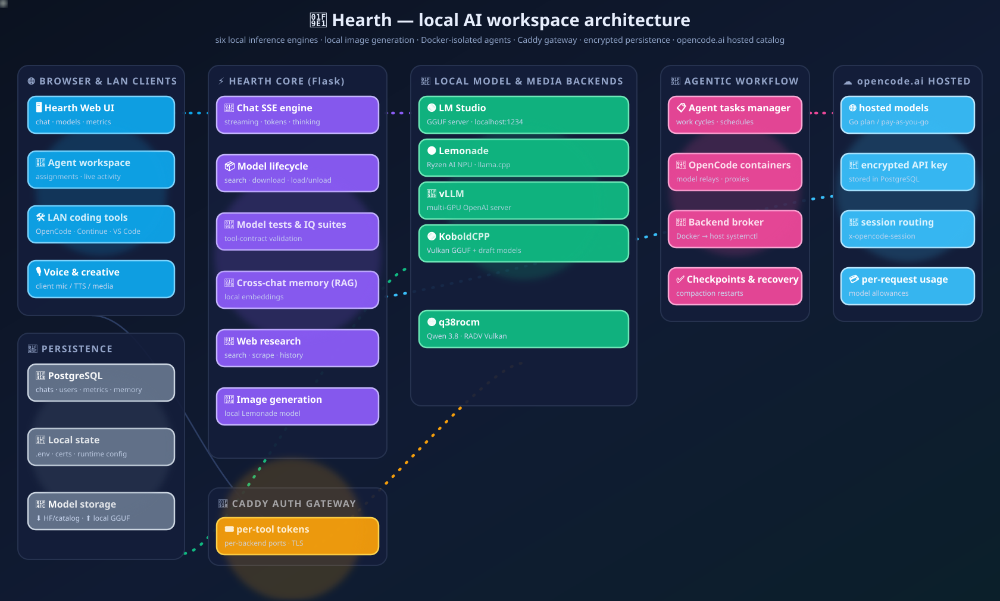

# llama-web

**A self-hosted workspace for local AI chat, model management, and coding agents.**

[Fixed ports](#fixed-ports) · [Installation](#installation) · [Features](#features) ·
[Development](#development)

## Fixed ports

These ports are part of the llama-web installation contract. Do not change them
without updating the systemd units, Caddyfile, and client configuration together.

| Port | Service | Binding | Purpose |
|---|---|---|---|
| 18471 | Caddy | `127.0.0.1` only | Local reverse proxy for OpenAI-compatible clients; forwards to 18474 |
| 18472 | PostgreSQL | `127.0.0.1` only | Application database (`llama-web`) |
| 18473 | llama.cpp engine (`llama-server`) | `127.0.0.1` only | Model inference, `/v1/models`, `/v1/chat/completions` |
| 18474 | llama-web app | `0.0.0.0` | HTTPS web UI and API; Tailscale access uses this port |

The app listens on 18474 with the `PORT=18474` environment variable set in
`~/.config/systemd/user/llama-web.service`. The same value is used by the session
cookie name, help/config generation, and the Tailscale certificate command.

## Features

| Area | Capabilities |
|---|---|
| Chat | JavaScript-driven streaming, saved conversations, regenerate, edit, and delete chats, remembered model selection, attachments, Markdown, and code blocks |
| Model management | List downloaded GGUF models, load a model, set its context size, and see each model's maximum supported context on its label |
| Coding agents | OpenCode tasks, live progress, workspace checkpoints, verification commands, schedules, and reusable skills |
| Research and memory | Web search and browser-based page retrieval, searchable browse history, and cross-chat recall using local embeddings |
| Voice and translation | Microphone transcription, spoken replies, and supported local text, image, and video translation workflows |
| Coding clients | Authenticated OpenAI-compatible endpoints and generated configurations for OpenCode, Continue, and compatible clients |
| Administration | User accounts and roles, backend settings, service controls, and live logs |

Feature availability depends on the installed models, host hardware, and configured
runtime. See the [installation guide](deploy/FIRST_TIME_INSTALL.md) for prerequisites
and operational details.

## Architecture

llama-web provides the web interface and coordinates the local llama.cpp engine. It
stores application data in PostgreSQL and keeps model execution in the local runtime.

<p align="center">
  
</p>

## Supported model backends

| Backend | Typical use | Notes |
|---|---|---|
| llama.cpp (`llama-server`) | Local chat and GGUF models | Serves models from the configured model directory on port 18473 |

Check each model's license and hardware requirements before downloading. See the
[installation guide](deploy/FIRST_TIME_INSTALL.md) for runtime configuration.

## Screenshots

[](docs/screenshots/hearth-feature-demo.mp4)

| Chat | Models |
|---|---|
|  |  |

| Model tests | Coding agents |
|---|---|
|  |  |

## Installation

- **Ubuntu:** From the project checkout, run `bash deploy/install-first-time.sh`. This
  installs and configures the app, PostgreSQL, and required host components.
- **Windows, macOS, or Linux release bundle:** Download a matching bundle from GitHub
  Releases and follow its included setup instructions.
- **Linux Docker deployment:** Run `bash deploy/install-docker.sh` for the containerized
  app deployment.

The first visit prompts you to create the administrator account. Configure at least
one model backend in **Settings**, then download and load a model from **Downloads** or
**Models**. See [deploy/FIRST_TIME_INSTALL.md](deploy/FIRST_TIME_INSTALL.md) for the
complete installation, backend, networking, and maintenance instructions.

## Local model evaluation

The **Model tests** page evaluates supported chat models with compatibility, reasoning,
safety, and tool-use checks. Results include per-check details and response previews.
Administrators can save reusable test scenarios with expected answers.

## Coding agents and client access

Hearth can run project tasks through OpenCode in isolated agent environments. Tasks can
include project files, requirements, verification commands, and reusable skills. The
Agents pages show progress and results, and support scheduled work where configured.
Assignments are private by default. Explicit sharing gives recipients read access
to status and completed results. Controls, schedules, and private workspace files
remain available to the owner. You can draft a task from Chat and see its status
and results in the linked conversation.

For desktop or LAN coding clients, Hearth can generate OpenCode and Continue
configurations for supported model endpoints. The gateway uses authentication and TLS.
Hosts and clients configured for Tailscale can use it for remote access.

## OpenCode context compaction

OpenCode compaction budgets scale with the selected model's loaded context. When Keep
and Buffer are blank, Hearth calculates them as follows:

```text
buffer         = max(1, context // 12)
prompt_reserve = max(1, context // 64)
keep           = max(0, context - buffer - prompt_reserve)
```

For a 65,536-token context, this yields a 5,461-token buffer, a 1,024-token prompt
reserve, and 59,051 tokens to keep. Explicit settings are bounded so the combined
budget fits the loaded context.

## Data, access, and safety

- PostgreSQL stores accounts, conversations, settings, model-test reports, metrics, and
  agent task records. Back up PostgreSQL and any local files you want to retain.
- Model files and generated media are stored in configured local directories or backend
  caches. Their storage requirements depend on the models you choose.
- Account ownership protects private content. Administrators can view system-wide Live Logs.
  The coding gateway uses separate
  authenticated endpoints; configure TLS and network access for your environment.
- Chat requests go to the selected local backend or optional hosted provider. Web
  research and other integrations may contact the providers you configure.
- **Use at your own risk.** Hearth is not a platform for investment advice, including
  advice about stocks, securities, tickers, Nasdaq or S&P indexes, index funds, ETFs,
  or trading. It is not a healthcare provider and does not provide medical advice,
  diagnoses, or treatment plans. Consult qualified financial or medical professionals
  for decisions in those areas; seek emergency care for urgent medical concerns.
- Hearth is not responsible for model-generated results, errors, or decisions made
  from them. Model responses may be inaccurate or unsuitable; review them and check
  model licenses and provider terms before use.

## Development

Application code is organized under `hearth/` by domain. `app.py` is the web entry
point, `deploy/` contains installation and service configuration, and `tests/` contains
the regression suite.

Run the project checks from the repository root:

```bash
.venv/bin/python tools/run_tests.py
```

To include browser coverage:

```bash
.venv/bin/python tools/run_tests.py --browser
```

The browser runner discovers `tools/check_*_ui.py` suites and lists named checks
for desktop and mobile pages, route permissions, and sign-in flows.

For a live Playwright MCP chat regression, keep Hearth running with a chat model
selected for the `admin` account and run:

```bash
.venv/bin/python tests/run_playwright_mcp_chat_regression.py
```

This sends a real Hearth chat request through that account's saved active model and
the running Playwright MCP, checks a Great Clips salon in Rochester, NY, and removes
the successful test conversation afterward. It does not load or switch models.

For environment setup and deployment options, see the
[installation guide](deploy/FIRST_TIME_INSTALL.md).
